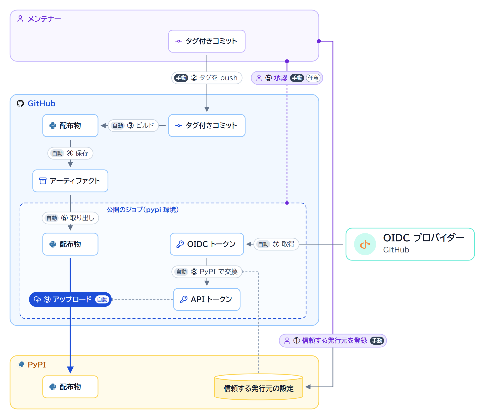

# draw-flow-diagram

システムの構成図・全体の流れ・工程（スイムレーン）・外部処理の図を、コードで SVG と PNG に描くためのスキルです。日本語のドキュメント向けに作っています。



上の図は同梱の例で、GitHub Actions から PyPI へ公開する仕組み（Trusted Publishing）を、公式の文書で確かめて描いたものです。

## できること

- **決まりに沿って描く**: 図の読み違いを防ぐ決まりに従って描きます。
  - もの（データ・画像・待ち行列）は箱、作業は線の上の札にする
  - 札には「自動」「手動」「任意」を付ける
  - 主の工程を青で強調する
  - 製品のもの（GitHub・Cloudflare・Python など）には、その製品のアイコンを使う
  - 箱には名前だけを書き、説明文を入れない
- **事実を確かめてから描く**: 流れはコード（公開の仕組みなら公式の文書）で確かめてから描き、確かめた場所と、判断した点を報告します。
- **作り直せる**: 図は Python のスクリプトとして残るので、手直しや作り直しが簡単です。
- **自分で確認する**: 書き出した PNG を Claude が自分で見て、重なり・はみ出し・空きすぎをチェックリストで確かめてから報告します。
- **指摘を残す**: 受けた指摘は、プロジェクトの `DRAWING_RULES.md` に原則として書き足し、次の図に生かします。

## 入れ方

このフォルダを、次のどちらかに置きます。

- すべてのプロジェクトで使う: `~/.claude/skills/draw-flow-diagram/`
- 1つのプロジェクトだけで使う: `<プロジェクト>/.claude/skills/draw-flow-diagram/`

置いたあとは、「この仕組みの工程図を作って」「構成図を描いて」のように頼むと使われます。

## 必要なもの

| もの | 用途 |
|---|---|
| Python 3.9 以上 | 図のスクリプトを動かす |
| Pillow | 文字の幅を測る（無ければ概算） |
| Playwright と Chromium | SVG を PNG に書き出す |
| 日本語フォント | 文字の幅を測り、PNG に描く |

```
pip install -r requirements.txt
playwright install chromium
```

フォントは、次の順に探します。

- Windows: BIZ UDPゴシック（標準で入っている）、游ゴシック、メイリオ
- macOS: ヒラギノ角ゴシック
- Linux: Noto Sans CJK

製品のアイコンを新しく取ってくるときだけ、ネットワーク（cdn.jsdelivr.net）を使います。送るのはアイコンの名前だけです。

## 例を動かす

```
python examples/minimal_steps.py            # 小さな雛形（examples/out/minimal_steps.png）
python examples/pypi_trusted_publishing.py  # 上の図
```


## 構成

```
draw-flow-diagram/
├── SKILL.md                    スキル本体（手順と決まり。Claude が読む）
├── references/
│   ├── diagram-types.md        図の種類ごとの配置の型
│   └── review-checklist.md     PNG を確かめるチェックリスト
├── scripts/
│   ├── diagram_kit.py          図の部品（箱・円柱・札・帯・範囲の枠・線）
│   ├── icons.py                アイコンの描画
│   ├── icons_extra.json        取ってきたアイコン（製品 37・汎用 16）
│   ├── fetch_icons.py          アイコンを取ってくる
│   └── render.py               SVG を PNG にする
├── examples/                   例のスクリプトと書き出した図
├── LICENSE
└── THIRD_PARTY_NOTICES.md
```

## アイコンを足す

```
python scripts/fetch_icons.py notion supabase        # 製品のアイコン（Simple Icons）
python scripts/fetch_icons.py --lucide smartphone    # 汎用のアイコン（Lucide）
python scripts/fetch_icons.py --list                 # 手元にあるアイコン
```

製品の名前（slug）は <https://simpleicons.org> で探せます。Microsoft・AWS・Slack・OpenAI などは、権利者の求めで Simple Icons から外されているため使えません。その場合は汎用のアイコンで描きます。

一部のアイコン（Android・Git など）には、出典の表示などが要る個別のライセンスがあります。取ってくるときに注意が表示されるので、図を公開する場所に必要な表記を付けてください。

## 他の言語で使う

図の文字は日本語を前提にしています。英語などで描く場合は、`scripts/diagram_kit.py` の次の設定を変えてください。

- `TAGS`: 札の「自動」「手動」「任意」の文字
- `FONT`: 使うフォント
- `FONT_FILES`: 文字の幅を測るフォントのファイル

## 動作の確認

Windows 11（Python 3.13、Pillow 12.0、Playwright 1.57）で確かめています。macOS と Linux は、フォントの場所を用意しただけで、まだ確かめていません。

## ライセンス

- このスキル独自の部分（SKILL.md・references・scripts と examples のコード・例の図）は MIT License です（Copyright (c) 2026 nKos）。`LICENSE` を見てください。
- アイコンのデータは、Lucide（ISC。Feather 由来のものは MIT）と Simple Icons（CC0）の条件に従います。詳しくは `THIRD_PARTY_NOTICES.md` を見てください。
- 製品のロゴは各社の商標です。製品を示すためだけに使い、形を変えず、各社のブランドの指針に従ってください。
